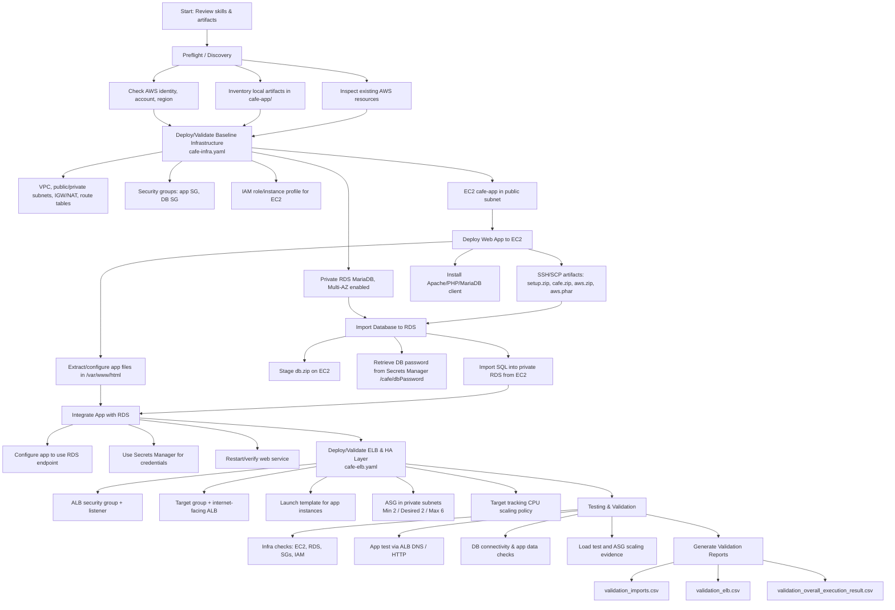

## Purpose
This repo (seis615) is an AWS Cafe application deployment and high-availability workspace. It contains infrastructure-as-code (CloudFormation), operational “skill” playbooks, Cafe web/database artifacts, 
and validation reports for importing the app to EC2/RDS and extending it with an ALB + Auto Scaling architecture.

This document summarizes the high-level workflow for deploying, integrating, and validating the Cafe application infrastructure in this repository.

## Process Flow

## Key Artifacts

- **Skills/playbooks**: `SKILL_IMPORTS.md`, `SKILL_ELB.md`, `SKILL_orchestrator.md`, `cafe-app/SKILL_IMPORTS.md`, `cafe-app/SKILL_ELB.md`
- **Infrastructure templates**: `cafe-infra.yaml`, `cafe-elb.yaml`, `cafe-app/cafe-infra.yaml`, `cafe-app/cafe-elb.yaml`
- **Application artifacts**: `cafe-app/web_app/` (web app, SDK, setup scripts), `cafe-app/db_app/db.zip`
- **Validation outputs**: `validation_imports.csv`, `validation_elb.csv`, `validation_overall_execution_result.csv`

**Top-Level Objects**

**cafe-app/ Contents**

# SEIS615 Cafe App - High-Level Process Flow

