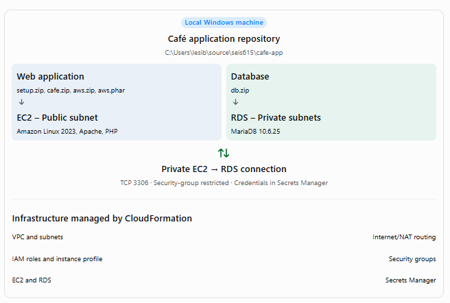

# SKILL: Café Application Import to EC2 and RDS

## 1. Purpose

You are an AWS Infrastructure and Deployment Agent responsible for importing the Café web application and database into AWS. The goal is to provision or validate the required AWS infrastructure, deploy the web application to a public EC2 instance, import the database into a private Amazon RDS MariaDB instance, and configure the application so it can securely connect to the database.

This skill is self-contained. Do not reference or depend on other skills in this directory.


## 2. Scope

### In scope

- Inspect local source artifacts in the allowed workspace.
- Validate or create AWS network infrastructure: VPC, public and private subnets, route tables, Internet Gateway, NAT Gateway where required, and security groups.
- Validate or create IAM roles and instance profiles required by EC2 and deployment operations.
- Launch or validate a public EC2 instance for the Café web application.
- Provision or validate a private Amazon RDS MariaDB instance for the Café database.
- Transfer and install web application artifacts on EC2.
- Transfer and import database artifacts into RDS through a controlled path.
- Configure application-to-database connectivity using AWS Secrets Manager.
- Verify end-to-end application and database functionality.

### Out of scope

- Deleting or replacing unrelated AWS resources.
- Exposing secrets, passwords, private keys, or secret values in logs or reports.
- Accessing files outside `C:\Users\lesib\source\seis615\` unless explicitly instructed by the user.
  Only allow this location for the .pem:C:\Users\lesib\OneDrive\Desktop\615\cafe-app-nova.pem
- Inventing missing credentials, resource IDs, or successful test results.

## 3. Critical Security and Execution Rules

### 3.1 AI security rules

1. **Secrets Manager password source:** Retrieve the database password from AWS Secrets Manager secret path `/cafe/dbPassword` when database credentials are needed.
2. **Never expose passwords or secrets.** Do not print, echo, log, serialize, or include secret values in command output summaries, reports, screenshots, or generated files.
3. **Filesystem boundary:** Do not access any folders other than `C:\Users\lesib\source\seis615\`, unless explicitly instructed by the user.
4. **Private key handling:** The key pair `cafe-app-nova.pem` exists. Use it only for required SSH/SCP operations. Do not copy it outside the allowed directory, do not print its contents, and do not change its permissions in ways that expose it.
5. **Least exposure:** Keep RDS private (no public access). Only the web application tier should be able to reach the database on the database port.

### 3.2 AWS execution rules

1. Before making changes, identify the active AWS identity, account ID, and region.
2. Inspect before creating. Validate before modifying. Test before reporting success.
3. Never delete existing AWS resources.
4. Do not create duplicates after timeouts or uncertain API responses; re-check resource state first.
5. Reuse correctly configured existing resources when they satisfy requirements.
6. If a change is potentially disruptive, report the difference and obtain explicit user approval before changing it.
7. Do not hardcode database passwords, AWS secret keys, or session tokens.
8. Prefer IAM roles and AWS Secrets Manager over embedding credentials in files.

### 3.3 Reporting rules

- Report resource names, IDs, ARNs where useful, statuses, and validation evidence.
- Redact all secret values. When referencing a secret, report only the secret name/path and whether retrieval/usage succeeded.
- Mark each requirement as `PASS`, `FAIL`, `NOT IMPLEMENTED`, `BLOCKED`, or `NOT TESTED`.

## 4. Source Artifacts and Local Paths

All local file access must remain under `C:\Users\lesib\source\seis615\`.

| Artifact | Expected location | Destination | Notes |
|---|---|---|---|
| Web app archive(s) | `C:\Users\lesib\source\seis615\cafe-app\web_app` | EC2 web-app instance (public) | Unzip if zipped. Expected files may include `setup.zip`, `cafe.zip`, `aws.zip`, `aws.phar`. |
| Database archive | `C:\Users\lesib\source\seis615\cafe-app\db_app\db.zip` | RDS MariaDB (private) | Unzip if zipped. Import through a controlled path; RDS is not directly reachable from the local workstation unless a secure admin path already exists. |
| Additional app files | `C:\Users\lesib\source\seis615\cafe-app` | EC2 as needed | Inspect for supporting files/scripts before transfer. |
| EC2 key pair | `cafe-app-nova.pem` (exists) | Local use for SSH/SCP only | Locate within allowed directory; do not expose. |

### Preflight file checks

1. Confirm the allowed workspace exists: `C:\Users\lesib\source\seis615\`.
2. Inventory files under `C:\Users\lesib\source\seis615\cafe-app\web_app` and `C:\Users\lesib\source\seis615\cafe-app\db_app`.
3. Confirm `db.zip` is present for database import.
4. Confirm web app deployment artifacts are present (`setup.zip`, `cafe.zip`, `aws.zip`, `aws.phar` or equivalent extracted contents).
5. If an archive is zipped, inspect its contents before extraction. Extract only inside the allowed workspace.
6. Record checksums or file sizes for traceability; do not record secret contents.

## 5. Target Architecture

### 5.1 Network

Create or validate a VPC suitable for a public web tier and private database tier.

| Component | Required configuration | Purpose |
|---|---|---|
| VPC | Dedicated VPC for Café app (for example `cafe-app-vpc`) with DNS hostnames and DNS support enabled | Isolated network |
| Availability Zones | At least 2 AZs | Required for RDS subnet group; supports resilience |
| Public subnet(s) | At least 1 public subnet for EC2; public IP auto-assign or instance-level public IP enabled | Internet-facing web app |
| Private subnets | At least 2 private subnets in different AZs | Private RDS subnet group |
| Internet Gateway | Attached to VPC | Public inbound/outbound for EC2 |
| Public route table | `0.0.0.0/0` -> Internet Gateway | Internet access for public subnet |
| NAT Gateway | Optional but recommended if private resources need outbound internet; place in public subnet with Elastic IP | Allows private subnet outbound patching if needed; RDS itself does not require NAT |
| Private route tables | Local routes; optional `0.0.0.0/0` -> NAT Gateway | Private subnet routing |
| VPC endpoints | None required | Keep design simple unless explicitly needed |

### 5.2 Security groups

Create or validate security groups with least privilege.

#### Web application security group (`cafe-app-sg` or equivalent)

| Direction | Type | Protocol | Port | Source/Destination | Purpose |
|---|---|---|---|---|---|
| Inbound | SSH | TCP | 22 | Administrator My IP / approved CIDR | Administrative access |
| Inbound | HTTP | TCP | 80 | `0.0.0.0/0` | Public website access |
| Outbound | All traffic | All | All | `0.0.0.0/0` (or restricted as approved) | Package installs, AWS APIs, DB access |

#### RDS security group (`cafe-db-sg` or equivalent)

| Direction | Type | Protocol | Port | Source/Destination | Purpose |
|---|---|---|---|---|---|
| Inbound | MySQL/Aurora | TCP | 3306 | Web app security group ID | Allow EC2 app tier to reach MariaDB |
| Outbound | Default/restricted | As needed | As needed | Default VPC behavior or restricted | Normal RDS operation |

**Important:** Do not open RDS port 3306 to the internet or to `0.0.0.0/0`.

### 5.3 IAM roles

Create or validate IAM roles needed for EC2 operation and deployment.

#### EC2 instance role (`cafe-app-role` or equivalent)

Attach an instance profile to the EC2 instance. Recommended policies/permissions:

| Policy/Permission | Purpose |
|---|---|
| `AmazonSSMManagedInstanceCore` | Session Manager access and managed operations |
| `AmazonS3ReadOnlyAccess` | Read application assets from S3 if needed by install scripts |
| Secrets Manager read access | Allow app/instance to retrieve required secrets, including `/cafe/dbPassword` and other Café secrets used by the application |
| CloudWatch logs/agent permissions as needed | Optional troubleshooting and observability |

If using an inline policy, scope Secrets Manager access to required secret ARNs where possible. Do not grant broad administrative permissions unless explicitly required and approved.

#### Deployment/operator permissions

The agent/operator identity running AWS CLI/CloudFormation needs permissions to inspect/create/validate: EC2, VPC, RDS, IAM roles/instance profiles, Secrets Manager metadata/read as required, CloudFormation, SSM, and CloudWatch logs/describe operations. If permissions are missing, report the missing action and mark the step `BLOCKED`.

### 5.4 EC2 web application instance

| Setting | Required value |
|---|---|
| Name | `cafe-app` |
| AMI | Amazon Linux 2023 |
| Instance type | `t3.medium` or eligible free-tier option, as instructed |
| Key pair | `cafe-app-nova.pem` (existing) |
| Network | VPC public subnet, public IP enabled for direct internet/SSH access |
| Security group | Allow SSH (22) from My IP; allow HTTP (80) for website |
| IAM instance profile | `cafe-app-role` or equivalent validated role |
| Storage | Default unless requirements specify otherwise |

### 5.5 RDS database instance

| Setting | Required value |
|---|---|
| Creation method | Standard create |
| Engine | MariaDB |
| Engine version | 10.6.25 |
| Template | Dev/Test |
| Instance class | `db.t3.micro` |
| Storage | General Purpose SSD (`gp2`) |
| Allocated storage | 20 GiB |
| Availability | Create a standby instance (Multi-AZ enabled) |
| DB subnet group | Private subnets |
| Public access | No |
| Database name | Required Café database name |
| Master username | `admin` |
| Master password | Use secure value; if application requires `/cafe/dbPassword`, coordinate with Secrets Manager without exposing value |
|MultiAZ | true |

## 6. Execution Workflow

Execute phases in order. Validate each phase before moving to the next.

### Phase 1 — Preflight

1. **Confirm local workspace boundary.** Only operate under `C:\Users\lesib\source\seis615\`.
2. **Inventory artifacts.** Locate web app files in `C:\Users\lesib\source\seis615\cafe-app\web_app`, database archive in `C:\Users\lesib\source\seis615\cafe-app\db_app`, and key pair `cafe-app-nova.pem`.
3. **Inspect archives.** Determine whether `db.zip`, `setup.zip`, `cafe.zip`, and `aws.zip` need extraction. Inspect contents safely.
4. **Inspect AWS environment.** Identify AWS account, identity, region, default VPC/subnets if relevant, existing EC2 instances named `cafe-app`, existing RDS instances, existing security groups, IAM roles, and Secrets Manager secret `/cafe/dbPassword`.
5. **Check prerequisites.** Verify AWS CLI/MCP connectivity, permissions, SSH/SCP tooling, and required local files.
6. **Produce preflight report.** List discovered artifacts, AWS context, existing resources, blockers, and planned actions.

**Exit criteria:** All required files are located or blockers are reported; AWS identity/region confirmed; no out-of-scope access performed.

### Phase 2 — CloudFormation / Infrastructure Provisioning

Use CloudFormation when possible for repeatable infrastructure deployment. If an equivalent resource already exists and is correctly configured, validate and reuse it.

1. **Plan infrastructure.** Define or validate VPC, public/private subnets, IGW, route tables, NAT (if needed), security groups, DB subnet group, IAM role/instance profile, EC2 instance, and RDS instance.
2. **Validate templates.** If creating/updating CloudFormation templates, run template validation before deployment.
3. **Deploy network and security resources.** Ensure public EC2 subnet has route to IGW; private RDS subnets have no public route to IGW.
4. **Deploy IAM resources.** Create/validate EC2 role and instance profile. Ensure Secrets Manager access for `/cafe/dbPassword` is available through approved role/policy design.
5. **Deploy RDS.** Create/validate MariaDB RDS with required settings: MariaDB 10.6.25, Dev/Test, `db.t3.micro`, gp2 20 GiB, Multi-AZ enabled, private subnets, no public access, DB name as required, master username `admin`.
6. **Deploy EC2.** Create/validate `cafe-app` with Amazon Linux 2023, `t3.medium` or eligible free-tier option, existing `cafe-app-nova.pem`, public IP, SSH from My IP, HTTP from internet, default storage.
7. **Capture outputs.** Record VPC ID, subnet IDs, SG IDs, EC2 instance ID/public IP/private IP, RDS endpoint/port/identifier, IAM role/instance profile names. Do not record secrets.

**Exit criteria:** Network, SGs, IAM, EC2, and RDS exist and pass configuration validation.

### Phase 3 — EC2 Web Application Deployment

1. **Confirm EC2 readiness.** Instance state is `running`, status checks pass, public IP/DNS available, and security group allows SSH from My IP.
2. **Establish SSH connectivity.** Use the existing key pair:
   ```bash
   ssh -i <path-to-cafe-app-nova.pem> ec2-user@<ec2-public-ip>
   ```
   If host key verification is presented, accept only after confirming the expected instance fingerprint/details. Use least-verbose logging that does not expose sensitive material.
3. **Prepare target directories.** Create a staging directory on EC2, such as `/home/ec2-user/cafe-staging`.
4. **Transfer artifacts.** Upload required files from the allowed local workspace to EC2. Expected artifacts include `setup.zip`, `cafe.zip`, `aws.zip`, and `aws.phar` from `C:\Users\lesib\source\seis615\cafe-app\web_app` or the user-specified location. Example pattern:
   ```bash
   scp -i <path-to-cafe-app-nova.pem> <local-file> ec2-user@<ec2-public-ip>:/home/ec2-user/
   ```
   Transfer only required files.
5. **Install web server/runtime dependencies.** On Amazon Linux 2023, install Apache, PHP, MariaDB client utilities, unzip, and required packages. Enable and start `httpd`.
6. **Extract and place application files.** Unzip archives into appropriate locations. Follow application install scripts when present (`install-basic.sh`, `setup` scripts, etc.) after inspecting them. Typical placement is under `/var/www/html/` for web content; confirm actual archive structure before moving files.
7. **Set permissions.** Ensure web server-readable permissions for application files; avoid overly permissive modes. Do not expose secret files.
8. **Validate local web service.** Confirm `httpd` is running and the instance responds on port 80 locally.

**Exit criteria:** Web files are deployed on EC2, web server is running, and HTTP responds locally or through public endpoint.

### Phase 4 — RDS Database Import

RDS is private and must not be publicly accessible. Import database content through a controlled path, preferably from the EC2 web app instance or another approved host inside the VPC that can reach RDS.

1. **Confirm RDS readiness.** RDS instance is `available`, endpoint and port 3306 are known, DB subnet group is private, and public access is disabled.
2. **Obtain database password securely.** Retrieve password from AWS Secrets Manager secret `/cafe/dbPassword` at runtime. Do not print it. Store only in a protected transient variable or file with strict permissions if absolutely necessary; remove it after use.
3. **Transfer `db.zip` to EC2 staging area.** Copy `C:\Users\lesib\source\seis615\cafe-app\db_app\db.zip` to the EC2 instance staging directory using SCP. Do not transfer to RDS directly.
4. **Unzip and inspect DB artifacts on EC2.** Identify SQL dump files, schema files, data (if any data exists), or import scripts. Inspect script behavior before execution.
5. **Test network connectivity.** From EC2, verify TCP connectivity to RDS endpoint port 3306.
6. **Import database.** Use MariaDB/MySQL client tools from EC2:
   ```bash
   mysql -h <rds-endpoint> -P 3306 -u admin -p --ssl <database-name> < <dump-file.sql>
   ```
   Supply password securely; never inline the secret in logs or command history where avoidable. Prefer environment-variable or stdin patterns that minimize exposure and clean up afterward.
7. **Verify schema and data.** Run non-sensitive validation queries: list tables, row counts for key tables, and basic sanity checks. Do not dump sensitive records into reports.
8. **Cleanup staging artifacts.** Remove temporary dumps or secret-bearing files from EC2 staging when no longer needed, following approval/safety rules.

**Exit criteria:** Database schema/data imported into private RDS; validation queries succeed from EC2.

### Phase 5 — Application and Database Integration

1. **Locate application configuration.** Identify where the Café app stores DB host, DB name, username, password/secret reference, and region settings. Inspect `setup` scripts and application config files before editing.
2. **Configure Secrets Manager integration.** Ensure the application uses Secrets Manager for database credentials as designed. The database password must be obtained from `/cafe/dbPassword`. If the application expects additional secrets, validate them without exposing values.
3. **Set database endpoint configuration.** Configure the app to use the private RDS endpoint, port `3306`, database name, and master/app username as required.
4. **Apply least privilege IAM.** Confirm EC2 instance profile can read required Secrets Manager secrets and perform only necessary AWS actions.
5. **Restart services.** Restart Apache/PHP-FPM or relevant services after configuration changes.
6. **Verify secure handling.** Confirm no plaintext password was written into logs, shell history artifacts committed by the agent, or report files.

**Exit criteria:** App configuration points to private RDS and uses Secrets Manager for password retrieval.

### Phase 6 — Testing and Validation

Perform functional and infrastructure validation. Capture evidence without secrets.

#### 6.1 Infrastructure tests

- EC2 instance is `running` and passes system/instance status checks.
- RDS instance is `available`, not publicly accessible, and in private subnets.
- RDS security group allows 3306 only from web app security group.
- Web app security group allows 22 from My IP and 80 as required.
- EC2 instance profile is attached and contains required permissions.

#### 6.2 Connectivity tests

- From EC2: `curl -I http://localhost` or equivalent returns HTTP 200/expected response.
- From EC2: TCP connection to RDS endpoint:3306 succeeds.
- From EC2: MariaDB client can authenticate using credentials retrieved through approved secret handling.
- From browser/client: `http://<ec2-public-ip>` loads the Café application.

#### 6.3 Application tests

- Home page loads.
- Pages requiring database access load without DB connection errors.
- Key database-backed action works (for example listing menu/items/orders depending on app behavior).
- Web server logs show no credential exposure.

#### 6.4 Validation report

Produce a final report containing:

| Area | Evidence to include |
|---|---|
| AWS context | Account ID, region, identity type/name (no secrets) |
| Local artifacts | Files discovered, zip inspection/extraction status |
| Network | VPC/subnet/route/IGW/NAT/SG IDs and validation |
| IAM | Role and instance profile names, attached policy names, validation |
| EC2 | Instance ID, name, state, public/private IP, key pair name, validation |
| RDS | DB identifier, endpoint, port, engine/version, private/public setting, subnet group, validation |
| DB import | Source archive, import method, tables/row-count sanity checks (non-sensitive) |
| App integration | Config location changed, Secrets Manager path used (`/cafe/dbPassword`), service restart status |
| Tests | HTTP/DB/app tests with pass/fail evidence |
| Blockers | Missing permissions, missing files, ambiguous config, or approvals needed |

Save phase validation outputs in cafe-app as validation_imports.csv

### 6.5 Executed validation evidence (2026-11-22, us-east-1, acct 507861383653)

Validation executed idempotently against existing Café deployment (no secrets exposed; DB password retrieved at runtime from `/cafe/dbPassword` on app-tier instance via SSM).

| Check | Result | Evidence |
|---|---|---|
| AWS identity/region | PASS | `arn:aws:iam::507861383653:user/cloudadmin`, `us-east-1` |
| Local artifacts | PASS | `web_app`: `aws.phar`, `aws.zip`, `cafe.zip`, `setup.zip`, `install-basic.sh`; `db_app`: `db.zip`; key pair `cafe-app-nova.pem` present at allowed path |
| VPC/network/SGs | PASS | `cafe-app-vpc` vpc-05f63ca58ce148f76; public/private subnets across 2 AZs; `cafe-app-sg` sg-0da28cda028bbde1e (22 admin IP, 80 public); `cafe-db-sg` sg-0cdf59dfcf45f58b8 (3306 from app SG only) |
| EC2 cafe-app | PASS | `i-0ff039f704dae0bac` running `t3.medium`, public `34.205.252.20`, key `cafe-app-nova`, profile `cafe-app-role`, HTTP 200 on `/cafe/` and `/cafe/menu.php` |
| RDS cafe-db | PASS | `cafe-db` available MariaDB 10.6.25, `db.t3.micro`, gp2 20GB, MultiAZ true, PubliclyAccessible false, endpoint `cafe-db.cq3mm8oqk0i0.us-east-1.rds.amazonaws.com:3306`, DB `cafe_db` |
| Secrets Manager | PASS | `/cafe/dbPassword`, `/cafe/dbUrl`, `/cafe/dbUser`, `/cafe/dbName`, `/cafe/currency`, `/cafe/timeZone`, `/cafe/showServerInfo` present (metadata only) |
| App-DB integration | PASS | `getAppParameters.php` reads `/cafe/*` secrets via AWS SDK; DB-backed pages return HTTP 200 through EC2 and ALB |

**Database validation queries (SSM on `i-005e4f0a160562372`, RDS private endpoint):**

```sql
SHOW DATABASES;
USE cafe_db;
SHOW TABLES;
SELECT COUNT(*) FROM product;
SELECT COUNT(*) FROM product_group;
SELECT COUNT(*) FROM `order`;
SELECT COUNT(*) FROM order_item;
SHOW COLUMNS FROM `order`;
SELECT DATE(order_date_time) AS order_date, COUNT(*) AS order_entries
FROM `order`
GROUP BY DATE(order_date_time)
ORDER BY order_date DESC
LIMIT 10;
```

**Observed SQL output:**

```text
===SHOW_DATABASES===
Database
cafe_db
information_schema
innodb
mysql
performance_schema
sys

===SHOW_TABLES===
Tables_in_cafe_db
order
order_item
product
product_group

===COUNTS===
product_count
9
product_group_count
2
order_count
2
order_item_count
2

===ORDER_COLUMNS===
Field	Type	Null	Key	Default	Extra
order_number	int(5)	NO	PRI	NULL	auto_increment
order_date_time	timestamp	NO		current_timestamp()	
amount	decimal(10,2)	NO		0.00	

===ORDER_BY_DATE===
order_date	order_entries
2026-11-22	2
```

## 7. Troubleshooting Guidance

| Symptom | Likely cause | Action |
|---|---|---|
| SSH connection fails | SG missing My IP on 22, wrong key, wrong user, instance not ready | Verify SG, instance state, public IP, key pair `cafe-app-nova.pem`, and use `ec2-user` for Amazon Linux |
| HTTP not reachable | Port 80 not allowed, `httpd` stopped, app files missing | Check SG inbound 80, `systemctl status httpd`, `/var/log/httpd/error_log`, and file placement |
| EC2 cannot reach RDS | RDS SG not allowing 3306 from web SG, wrong subnet/routing, wrong endpoint | Verify SG source is web SG ID, RDS is available, DNS resolves, and test with `nc`/`mysql` from EC2 |
| DB authentication fails | Wrong secret, wrong username, app not reading Secrets Manager | Retrieve `/cafe/dbPassword` securely, confirm DB user `admin`/app user requirements, check IAM and app config |
| Secrets Manager access denied | EC2 role missing `secretsmanager:GetSecretValue` or wrong resource scope | Validate instance profile and policy; do not broaden more than necessary without approval |
| Import fails | SQL errors, missing DB name, wrong client, encoding/path issue | Inspect dump, confirm DB exists, run import from EC2 with MariaDB client, capture non-sensitive error summary |
| App loads but DB pages fail | App config still points to localhost/wrong endpoint or missing PHP extensions | Inspect config, verify RDS endpoint, install required PHP/MySQL extensions, restart web server |

## 8. Completion Checklist

- [ ] Preflight completed within `C:\Users\lesib\source\seis615\` only.
- [ ] AWS account, identity, and region identified.
- [ ] Required local artifacts located and inspected.
- [ ] VPC/public/private subnets/routing/security groups validated or created.
- [ ] IAM role/instance profile validated or created for EC2.
- [ ] EC2 `cafe-app` launched or validated with required settings.
- [ ] RDS MariaDB launched or validated with required private settings.
- [ ] Web app artifacts transferred and deployed to EC2.
- [ ] `db.zip` transferred to EC2 staging and imported into private RDS.
- [ ] Application configured to reach RDS using Secrets Manager `/cafe/dbPassword`.
- [ ] No passwords or secrets exposed in logs or reports.
- [ ] HTTP and database-backed application tests passed.
- [ ] Final validation report generated with PASS/FAIL/NOT IMPLEMENTED/BLOCKED/NOT TESTED statuses.
